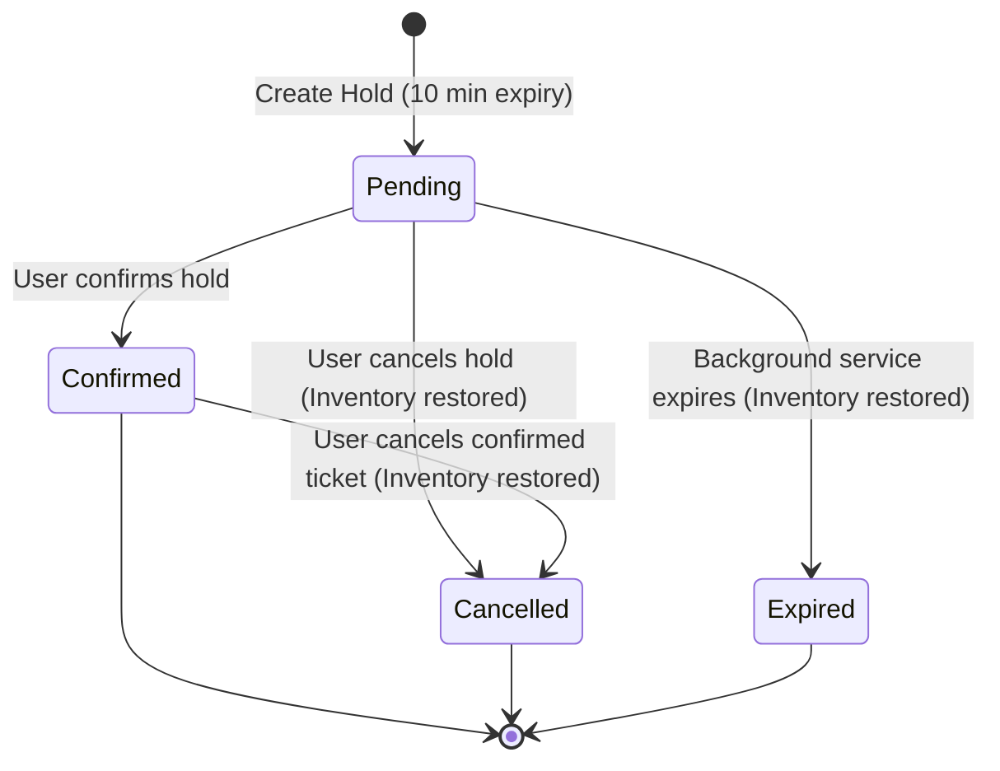

# SeatSure — Real-Time Event Ticketing & Reservation Platform

SeatSure is a robust, concurrent event ticketing and reservation platform built with **ASP.NET Core (.NET 8 LTS)**, following **Clean Architecture** principles.

The core mission of SeatSure is protecting a single, non-negotiable business invariant:
> **A ticket type is never sold beyond its capacity — `AvailableQuantity` never goes negative, even under high concurrency and race conditions.**

---

## 📑 Table of Contents
1. [Architecture Overview](#-architecture-overview)
2. [Domain Model & Database Design](#-domain-model--database-design)
3. [Concurrency & Inventory Protection](#-concurrency--inventory-protection)
4. [API Endpoints Documentation](#-api-endpoints-documentation)
5. [Real-Time Updates (SignalR)](#-real-time-updates-signalr)
6. [Background Hold Expiration](#-background-hold-expiration)
7. [Authentication & Authorization](#-authentication--authorization)
8. [Setup & Running Locally](#-setup--running-locally)
9. [Testing the Endpoints](#-testing-the-endpoints)

---

## 🏛 Architecture Overview

The system strictly follows **Clean Architecture** with a clear separation of concerns:

```
├── Seatsure.Domain          # Pure entities, enums, zero external dependencies
├── Seatsure.Application     # Use cases, interfaces, DTOs (records), service implementations
├── Seatsure.Infrastructure  # EF Core DbContext, Repositories, JWT, BCrypt password hashing
└── Seatsure (Web API)       # Controllers, Middlewares, SignalR Hub, BackgroundService, Program.cs
```

### Dependency Inversion in Practice (DIP)
- **Application Layer** defines the repository interfaces (`IEventRepository`, `ITicketTypeRepository`, `IReservationRepository`, `IUserRepository`, `IUnitOfWork`, `IAvailabilityNotifier`).
- **Infrastructure & API Layers** provide the implementations (`EventRepository`, `UnitOfWork`, `SignalRAvailabilityNotifier`).
- Dependencies always point **inward** toward the core domain.

---

## 🗄 Domain Model & Database Design

### Entities

| Entity | Purpose | Key Attributes |
|---|---|---|
| `User` | Attendees and Organizers | `Id (Guid)`, `Name`, `Email (Unique)`, `PasswordHash`, `Role (Organizer/Attendee)` |
| `Event` | Concerts/events created by Organizers | `Id`, `OrganizerId`, `Title`, `Description`, `VenueName`, `StartsAtUtc`, `Status (Draft/Published/Cancelled)` |
| `TicketType` | Ticket tiers for events (e.g. VIP, General) | `Id`, `EventId`, `Name`, `Price`, `TotalQuantity`, `AvailableQuantity`, `RowVersion` |
| `Reservation` | Temporary hold or confirmed ticket purchase | `Id`, `TicketTypeId`, `UserId`, `Quantity`, `Status (Pending/Confirmed/Expired/Cancelled)`, `HoldExpiresAtUtc` |

### Reservation Lifecycle (State Machine)



---

## ⚡ Concurrency & Inventory Protection

### Why Optimistic Concurrency (`RowVersion`)?
Ticketing systems experience sudden spikes in traffic (e.g., ticket drops). 
* **Pessimistic Locking** (`SELECT FOR UPDATE`) holds database locks across transactions, serializing requests, degrading throughput, and risking deadlocks under peak load.
* **Optimistic Locking** (`RowVersion` byte array on `TicketType`) allows parallel reads and writes. The database verifies the row version on commit.

### How it works in SeatSure:
1. `ReservationService` fetches the `TicketType` and verifies `Quantity <= AvailableQuantity`.
2. `AvailableQuantity` is decremented in memory.
3. EF Core includes `RowVersion` in the `UPDATE` SQL `WHERE` clause automatically:
   ```sql
   UPDATE TicketTypes 
   SET AvailableQuantity = @newQty 
   WHERE Id = @id AND RowVersion = @originalRowVersion;
   ```
4. If two users attempt to purchase the last ticket simultaneously, the second write encounters a mismatched `RowVersion` $\rightarrow$ EF Core throws `DbUpdateConcurrencyException`.
5. The service intercepts this and surfaces a clean **`409 Conflict`** with RFC 7807 Problem Details: `"Someone booked first. Please retry."`

---

## 🚀 API Endpoints Documentation

All errors are returned in standard **RFC 7807 Problem Details** (`application/problem+json`).

### 1. Authentication (`/api/auth`)
| Method | Endpoint | Access | Description | Status Codes |
|---|---|---|---|---|
| `POST` | `/api/auth/register` | Public | Register an Attendee (`1`) or Organizer (`0`) | `201 Created`, `400 Bad Request`, `409 Conflict` (Email taken) |
| `POST` | `/api/auth/login` | Public | Login with email and password to receive JWT | `200 OK` (`{ token, expiresAtUtc }`), `401 Unauthorized` |

### 2. Events (`/api/events`)
| Method | Endpoint | Access | Description | Status Codes |
|---|---|---|---|---|
| `GET` | `/api/events?page=1&pageSize=10` | Public | Paginated list of published events | `200 OK`, `400 Bad Request` |
| `GET` | `/api/events/{id}` | Public | Event details including available ticket types | `200 OK`, `404 Not Found` |
| `POST` | `/api/events` | Organizer | Create a new event draft | `201 Created`, `400 Bad Request`, `401 Unauthorized`, `403 Forbidden` |
| `POST` | `/api/events/{id}/publish` | Organizer (Owner) | Publish an event draft | `200 OK`, `403 Forbidden` (Not owner), `404 Not Found`, `409 Conflict` |

### 3. Ticket Types (`/api/events/{eventId}/ticket-types`)
| Method | Endpoint | Access | Description | Status Codes |
|---|---|---|---|---|
| `GET` | `/api/events/{eventId}/ticket-types` | Public | Get all ticket tiers for an event | `200 OK`, `404 Not Found` |
| `POST` | `/api/events/{eventId}/ticket-types` | Organizer (Owner) | Add a new ticket type (VIP, General, etc.) | `201 Created`, `400 Bad Request`, `403 Forbidden`, `404 Not Found` |

### 4. Reservations (`/api/ticket-types/...` & `/api/reservations/...`)
| Method | Endpoint | Access | Description | Status Codes |
|---|---|---|---|---|
| `POST` | `/api/ticket-types/{id}/reservations` | Authenticated | Place a 10-minute hold on tickets | `201 Created`, `400 Bad Request`, `404 Not Found`, **`409 Conflict`** (Sold out / Concurrency loss) |
| `POST` | `/api/reservations/{id}/confirm` | Authenticated (Owner) | Confirm a pending reservation | `200 OK`, `403 Forbidden`, `404 Not Found`, `409 Conflict` (Expired/Already confirmed) |
| `POST` | `/api/reservations/{id}/cancel` | Authenticated (Owner) | Cancel reservation & restore inventory | `200 OK`, `403 Forbidden`, `404 Not Found`, `409 Conflict` |
| `GET` | `/api/users/me/reservations` | Authenticated | List all reservations for the logged-in user | `200 OK`, `401 Unauthorized` |

---

## 📡 Real-Time Updates (SignalR)

* **Hub Route:** `/hubs/events`
* **Client Methods:**
  * `JoinEvent(eventId)`: Join a group channel for a specific event.
  * `LeaveEvent(eventId)`: Leave the event room.
* **Server Broadcast Event:**
  * `AvailabilityChanged(ticketTypeId, availableQuantity)`: Fired automatically on ticket hold creation, confirmation, cancellation, and background expiration.

---

## ⏱ Background Hold Expiration

SeatSure includes a dedicated `BackgroundService`:
* **Worker Class:** `HoldExpiryService`
* **Schedule:** Runs every 30 seconds.
* **Logic:** 
  1. Resolves a scoped `IReservationService` via `IServiceScopeFactory`.
  2. Queries for `Pending` reservations where `HoldExpiresAtUtc < DateTime.UtcNow`.
  3. Transitions status to `Expired`, atomically increments `TicketType.AvailableQuantity`, and commits.
  4. Broadcasts updated inventory counts over SignalR.

---

## 🔒 Authentication & Authorization

* **Mechanism:** JWT Bearer tokens signed with HMAC-SHA256.
* **Claims:**
  * `sub`: User ID (`Guid`)
  * `email`: User Email
  * `role`: `Organizer` or `Attendee`
* **Authorization Levels:**
  1. **Role-based:** `[Authorize(Roles = "Organizer")]` on administrative routes.
  2. **Resource-based / Ownership checks:** Service-layer verification that the logged-in organizer owns the event being modified/published.

---

## 💻 Setup & Running Locally

### Prerequisites
* [.NET 8 SDK](https://dotnet.microsoft.com/download/dotnet/8.0) or higher
* SQL Server (LocalDB, SQL Express, or Docker MSSQL)

### 1. Configure Connection String
Edit `Seatsure/appsettings.json`:
```json
"ConnectionStrings": {
  "DefaultConnection": "Server=.;Database=Seatsure;Trusted_Connection=True;TrustServerCertificate=True"
}
```

### 2. Apply Migrations
```bash
dotnet ef database update --project Seatsure.Infrastructure --startup-project Seatsure
```

### 3. Run the Application
```bash
dotnet run --project Seatsure
```

* **Swagger UI:** `http://localhost:5149/swagger`
* **SignalR Hub:** `http://localhost:5149/hubs/events`

---

## 🧪 Testing the Endpoints

A comprehensive, ready-to-run `.http` file is provided in [`Seatsure/Seatsure.http`](Seatsure/Seatsure.http). You can execute requests directly in VS Code (REST Client extension) or Visual Studio 2022.

---

## 🎯 Design Decisions & Trade-offs (FAQ for Discussions)

1. **Why `record` for DTOs and `class` for Entities?**
   * DTOs represent immutable value objects during network transit; `record` provides concise declaration and structural equality.
   * Entities possess database identity (`Id`) and require mutable state for EF Core change tracking.

2. **Why not MediatR / CQRS?**
   * For this domain scope, plain services provide explicit dependency flows, lower indirection, and minimal mental overhead while fully respecting Single Responsibility and Dependency Inversion.

3. **Why Custom Exceptions mapped via Middleware?**
   * Keeping HTTP-agnostic exceptions (`NotFoundException`, `ConflictException`, `ValidationException`) in the Application layer allows the business logic to be invoked by HTTP controllers, background workers, or CLI tools without HTTP dependencies.
